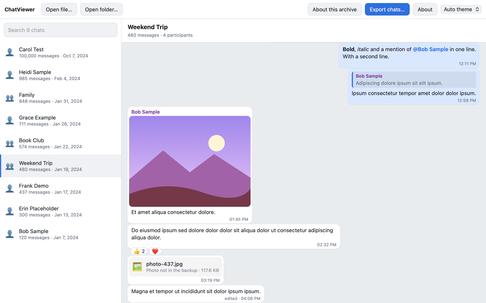
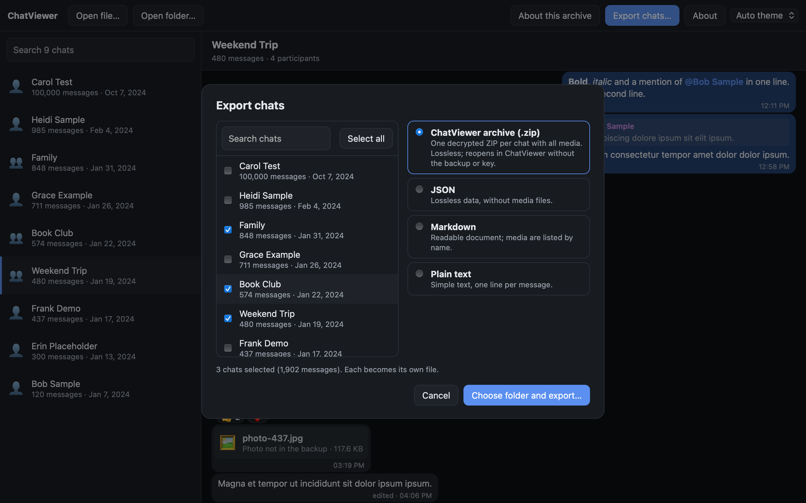
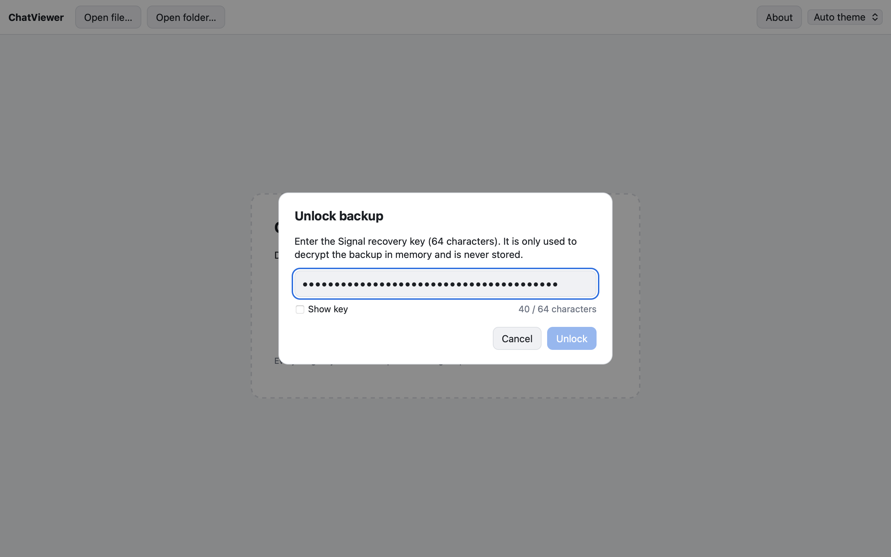

<div align="center">


# ChatViewer

**Open, read and archive your exported WhatsApp and Signal chats. Offline, on your own computer.**

[](https://github.com/NiklasPrahl/ChatViewer/actions/workflows/ci.yml)
[](https://github.com/NiklasPrahl/ChatViewer/releases)
[](#license)
[](#download)
[](#privacy-and-security)
<br />
[](https://www.rust-lang.org/)
[](https://tauri.app/)
[](https://react.dev/)

[Download](#download) · [Features](#features) · [Command line](#command-line) · [Archive format](docs/formats/cva.md) · [Architecture](docs/architecture.md)

<br />

<picture>
  <source media="(prefers-color-scheme: dark)" srcset="docs/images/app-dark.png" />
  
</picture>

<sub>All screenshots use synthetic demo data.</sub>

</div>

---

## Why ChatViewer?

Messenger exports are hard to use. A WhatsApp export is a text file full of
date formats and attachment markers. A Signal backup is one encrypted
bundle of *all* your chats. ChatViewer opens both, shows them like a
messenger, and lets you **split a backup into one self-contained,
decrypted archive per chat** that you can store and reopen on its own.

## Features

- 💬 **Messenger-style reading.** Bubbles, day separators, photos, videos,
  voice notes with waveforms, stickers, quotes (click to jump), reactions,
  polls, mentions, formatting, and edited and deleted messages.
- 🔐 **Signal on-device backups** in the cross-platform format from iOS,
  Android and Desktop. Unlock them with the 64-character recovery key,
  which is used in memory only.
- 🟢 **WhatsApp exports** from iOS and Android: `.zip`, `.txt` or an
  unpacked folder, in English and German. The date order and format
  variant are detected automatically.
- 📦 **Per-chat export.** Select any number of chats and get one ZIP each,
  with all media, readable without the original backup or key. Also
  JSON (lossless), Markdown and plain text.
- ♻️ **Lossless.** Every message keeps its original source record, so
  nothing is dropped, even data a later version will learn to show.
- 🌓 **Light, dark and auto themes.** Fast with chats of 100,000+
  messages.
- 🖥️ **Command line included.** `chatviewer info` and `chatviewer export`,
  also for batch exports.
- 🕵️ **Private by design.** No network access, no telemetry, nothing
  stored.

<table>
  <tr>
    <td width="50%"></td>
    <td width="50%"></td>
  </tr>
  <tr>
    <td align="center"><sub>Export many chats, one file each</sub></td>
    <td align="center"><sub>Unlock a Signal backup with its recovery key</sub></td>
  </tr>
</table>

## Supported sources

| Source | Input | Notes |
|---|---|---|
| **Signal** | `SignalBackups` folder (on-device backup) | iOS, Android and Desktop. Needs the recovery key. Tested with Signal Desktop 8.33. |
| **WhatsApp** | Exported chat as `.zip`, `.txt` or folder | iOS and Android, 12/24-hour, all date orders. System texts in English and German. |
| **ChatViewer archive** | `.zip` exported by ChatViewer | Opens without key or original backup. [Format specification](docs/formats/cva.md). |

The *About this archive* panel shows the detected format version,
warnings, and what a source cannot contain (for example, WhatsApp exports
have no reactions).

## Download

Get the installer for your system from the
[releases page](https://github.com/NiklasPrahl/ChatViewer/releases):

| System | File |
|---|---|
| macOS (Apple silicon) | `.dmg` |
| Windows | `-setup.exe` or `.msi` |
| Linux | `.deb`, `.rpm` or `.AppImage` |

Builds are not code-signed yet. The [release notes](docs/release-notes.md)
explain the one-time steps for macOS Gatekeeper and Windows SmartScreen, and
list a SHA-256 checksum for every file.

## Command line

The `chatviewer` CLI ships with the app. On macOS it is at
`ChatViewer.app/Contents/MacOS/chatviewer`, on Windows next to the app,
and on Linux at `/usr/bin/chatviewer`.

```bash
# What is in this archive? (--anonymous hides names, --stats adds counts)
chatviewer info ~/Downloads/SignalBackups --stats

# One decrypted, self-contained ZIP per Signal chat
chatviewer export ~/Downloads/SignalBackups --all --format cva --out-dir ~/Chats

# A single WhatsApp chat as Markdown
chatviewer export "WhatsApp Chat - Team.zip" --format md -o team.md
```

Recovery keys are read from a hidden prompt, or from stdin with
`--recovery-key-stdin`, never from arguments. Existing files are never
overwritten.

## Privacy and security

- **Offline.** The app never connects to the internet, and links in
  chats are not opened.
- **Nothing persists.** Chats, media and keys live in memory for the
  session only. The only setting stored is the theme.
- **You decide what is written.** Files are created only when you export,
  and exported archives are **decrypted**, so store them accordingly.
- **Redacted logs.** "Copy log" in error dialogs never contains message
  content or names.

## Building from source

Requirements: Rust 1.95+, Node.js 22 and cmake. On Linux, also the
WebKitGTK packages listed in [`ci.yml`](.github/workflows/ci.yml).

```bash
cd app && npm install && npm run tauri dev   # run the app
npm run dev:mock                             # UI only, with synthetic data
cargo test --workspace --all-features        # Rust tests
```

Installers (also needs `cargo-about`):

```bash
sh tools/licenses/generate.sh
sh tools/release/prepare-sidecar.sh
cd app && npm ci && npx tauri build --config src-tauri/tauri.release.conf.json
```

## Project documentation

- [Architecture](docs/architecture.md): format research, neutral chat
  model, modules.
- [Plan](docs/plan.md): milestones and test strategy.
- [Architecture decision records](docs/adr/): licensing, lossless import,
  Signal and WhatsApp details, packaging.
- [ChatViewer archive format](docs/formats/cva.md).

## Contributing

Contributions are welcome. Please keep everything in English and **never
commit real chats, backups, recovery keys, phone numbers or names**. The
tests use synthetic data only (`tools/fixture-gen`).

```bash
git config core.hooksPath .githooks   # once per clone; needs gitleaks 8.30+
```

The pre-commit hook and CI scan every change for secrets and personal
data.

## License

ChatViewer's own code is licensed under the [MIT License](LICENSE). The
Signal importer (`crates/cv-import-signal`) uses Signal's AGPL-3.0 backup
format definitions and is licensed
[AGPL-3.0-only](LICENSES/AGPL-3.0-only.txt). Release builds include it and
are therefore distributed under the AGPL-3.0 as a whole. Building without
the `signal` feature gives an MIT-only binary. Details are in
[ADR 0001](docs/adr/0001-license.md). Third-party notices are bundled
with the app.

<sub>WhatsApp and Signal are trademarks of their respective owners.
ChatViewer is an independent project and not affiliated with them.</sub>
